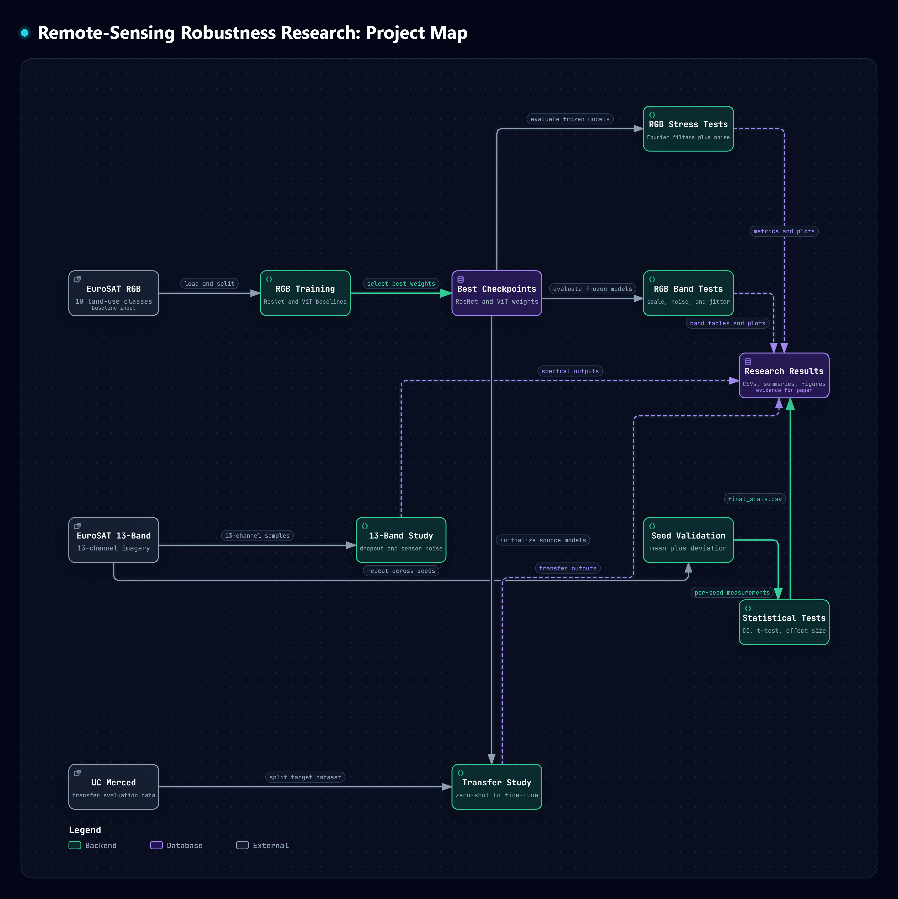
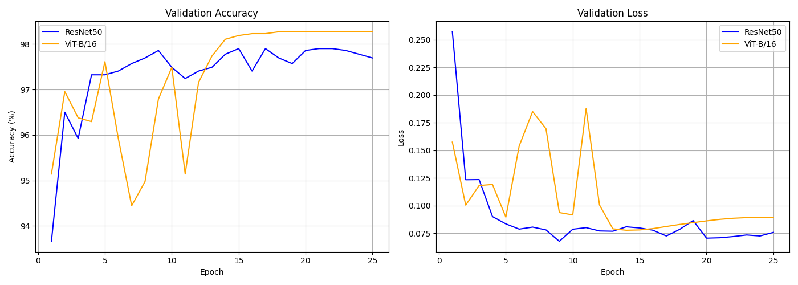

# Spectral and Corruption Robustness of ResNet34 and Vision Transformers

Experiments evaluating how ResNet34 (CNN) and ViT-S/16 (Vision Transformer) hold up on remote sensing imagery when spectral bands are removed or the input is corrupted. The work covers 13-band Sentinel-2 EuroSAT, RGB EuroSAT, and UC Merced transfer learning, with a local FastAPI dashboard for running the trained models.

## Project Overview



## Key Results

Both models are ImageNet-initialized, fine-tuned on 13-band EuroSAT (27,000 Sentinel-2 patches, 10 land-use classes), and evaluated on a stratified 70/15/15 split with three training seeds.

| Metric | ResNet34 | ViT-S/16 |
| --- | --- | --- |
| Clean test accuracy | **96.29%** | 94.45% |
| Clean macro-F1 | **96.14%** | 94.26% |
| Accuracy with red-edge bands removed | **83.21%** | 47.74% |
| Accuracy under 1x signal-dependent sensor noise | 28.35% | **57.79%** |

Takeaway: ResNet34 is more robust to losing spectral bands, while ViT-S/16 is more robust to sensor noise. Statistical comparisons use paired t-tests with Benjamini-Hochberg FDR control across 27 conditions, plus per-class precision, recall, F1, and confusion-matrix analysis. The full summary is in [`final_stats.csv`](final_stats.csv).



## Highlights

- PyTorch/timm training and evaluation pipelines for land-use classification.
- Robustness testing under band dropout, signal-dependent noise, and Rayleigh-weighted haze, in addition to clean evaluation.
- Spectral band sensitivity analysis across RGB and multispectral data.
- Statistical comparisons with confidence intervals, effect sizes, and multiple-comparison correction.
- Local FastAPI dashboard and REST API with cached model inference, top-3 confidence-gated predictions, and SQLite prediction history.

## Repository Structure

```text
.
├── data/
│   ├── EuroSAT.zip
│   └── README.md
├── checkpoints/
│   └── README.md
├── checkpoints_best/
│   └── README.md
├── train.py
├── random_seed_train.py
├── multispectral_analysis.py
├── spectral_band_analysis.py
├── noise_analysis.py
├── noise2_analysis.py
├── ucemerced_analysis.py
├── bh_correction.py
├── data_analysis.py
├── visualize.py
├── plot_rescue.py
├── verify_gpu.py
├── main.py
├── schema.sql
├── DBMS_INTEGRATION.md
├── final_stats.csv
├── Figure_1.png
├── ProjectDiagram.png
├── requirements.txt
└── .gitignore
```

## Main Scripts

**Training**
- `train.py` - trains ResNet and ViT models on EuroSAT imagery.
- `random_seed_train.py` - repeats training and evaluation across seeds for more reliable metrics.

**Robustness experiments**
- `multispectral_analysis.py` - analyzes multispectral model behavior and band sensitivity.
- `spectral_band_analysis.py` - evaluates the effect of spectral band removal and grouped band perturbations.
- `noise_analysis.py` and `noise2_analysis.py` - run noise robustness experiments.
- `ucemerced_analysis.py` - evaluates transfer learning on UC Merced.

**Statistics and plots**
- `bh_correction.py` - Benjamini-Hochberg FDR correction across the tested conditions.
- `data_analysis.py` - consolidates results into summary statistics.
- `visualize.py` and `plot_rescue.py` - generate plots.

**Utilities and application**
- `verify_gpu.py` - checks that PyTorch can see your GPU.
- `main.py` - FastAPI dashboard and REST API (see below).
- `schema.sql` and `DBMS_INTEGRATION.md` - SQLite schema and notes for prediction history.

## Dashboard and REST API

The trained ResNet34 and ViT-S/16 models can be served locally through a FastAPI app:

- cached model inference, so models load once instead of on every request
- top-3 predictions, gated by a confidence threshold
- SQLite history of past predictions

Place your trained checkpoints in `checkpoints_best/` (see [Notes on Large Files](#notes-on-large-files)), then run:

<!-- Confirm this command matches how main.py defines the app. -->
```bash
uvicorn main:app --reload
```

The dashboard and the interactive API docs (`/docs`) are then available at `http://localhost:8000`.

## Dataset Setup

`data/EuroSAT.zip` is included as the compact dataset archive. Before running local training, unzip it:

```bash
unzip data/EuroSAT.zip -d data/
```

Some scripts currently reference a local Windows path such as:

```text
D:\data\EuroSAT\2750
```

If your dataset is inside this repository, update the script path to:

```text
data/EuroSAT/2750
```

## Installation

Create a clean Python environment, then install dependencies:

```bash
pip install -r requirements.txt
```

For GPU training, install the PyTorch build that matches your CUDA version from the official [PyTorch instructions](https://pytorch.org/get-started/locally/), then run `python verify_gpu.py` to confirm it works.

## Running Experiments

```bash
python train.py
python random_seed_train.py
python noise_analysis.py
python spectral_band_analysis.py
python ucemerced_analysis.py
```

After the experiments finish, generate the statistics and plots:

```bash
python data_analysis.py
python bh_correction.py
python visualize.py
```

## Notes on Large Files

Model checkpoint folders are not included in this repository because they are very large. Store them with GitHub Releases, Google Drive, Hugging Face, Kaggle, or another artifact store.

The placeholder folders `checkpoints/` and `checkpoints_best/` are included so the expected output locations are clear.

## Result Files

- [`final_stats.csv`](final_stats.csv) - consolidated robustness and statistical summary.
- [`Figure_1.png`](Figure_1.png) - one generated figure from the analysis workflow.
- [`ProjectDiagram.png`](ProjectDiagram.png) - overview of the project pipeline.

## Datasets and Acknowledgements

- **EuroSAT**: Helber et al., "EuroSAT: A Novel Dataset and Deep Learning Benchmark for Land Use and Land Cover Classification," IEEE JSTARS, 2019.
- **UC Merced Land Use**: Yang and Newsam, "Bag-of-Visual-Words and Spatial Extensions for Land-Use Classification," ACM SIGSPATIAL GIS, 2010.
- Models are built with [PyTorch](https://pytorch.org/) and [timm](https://github.com/huggingface/pytorch-image-models).

Please check the original dataset terms before redistributing the data.

## License

This project is released under the MIT License. See [`LICENSE`](LICENSE) for details.
